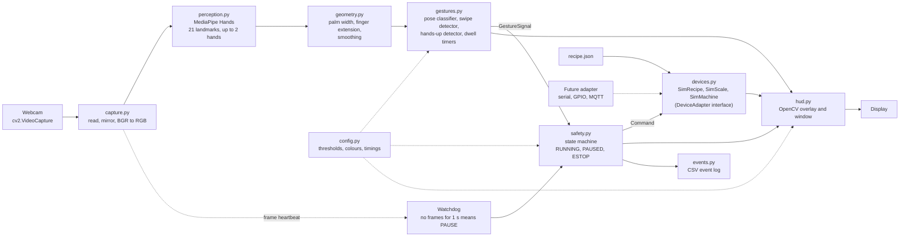
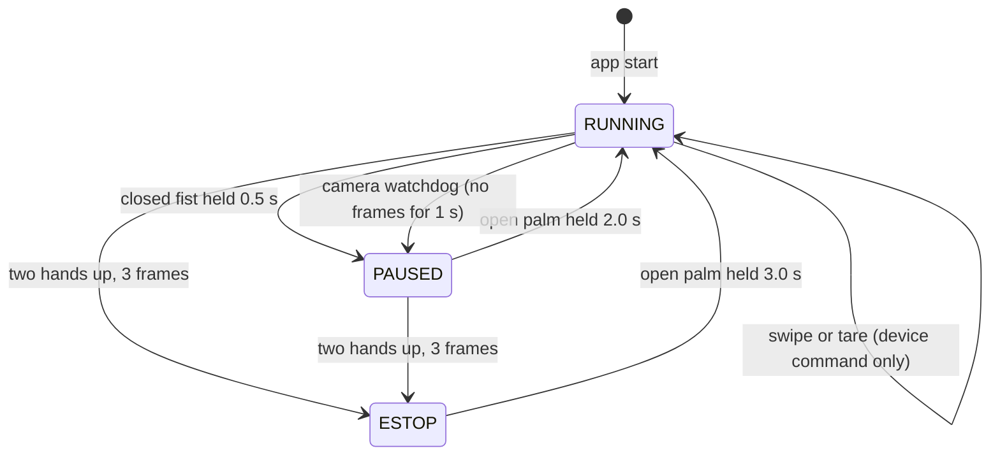
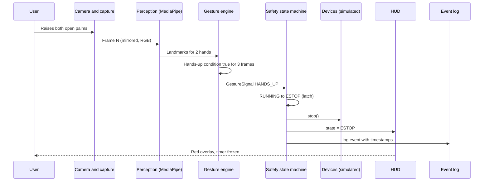

# Architecture.md — FieldHand System Architecture

| Field | Value |
|---|---|
| Document | `Architecture.md` v0.1 |
| Owner | Member 2 (Tech Lead & Delivery) |
| Style | Single-process, on-device pipeline. No backend, database or cloud by design. |
| Related | `PRD.md` (features, gesture table), `Design.md` (HUD, palette), `To-Do.md` (task IDs) |

> Diagrams use Mermaid, which renders on GitHub and in VS Code's Markdown preview.

---

## 1. Architecture Diagram

### 1.1 High-level data flow

The system is a straight pipeline run once per camera frame. Perception (what the hands look like) is kept separate from decision-making (what the gesture means) and from effects (what the devices do), so each layer can be tested and replaced on its own.



### 1.2 Safety state machine



Rules enforced in `safety.py`:

1. Priority: `ESTOP` > `PAUSE` > `RESUME` / `TARE` > swipe.
2. In PAUSED and ESTOP, every gesture is ignored except `ESTOP` (escalation) and `RESUME`.
3. `ESTOP` is latched. Only the 3-second palm hold clears it.
4. The machine timer is frozen in PAUSED and ESTOP and resumes from the frozen value.
5. Fail-safe bias: when in doubt, stop. Perception failure (watchdog) goes to PAUSED, never to RUNNING.

### 1.3 Sequence: emergency stop



---

## 2. Technology Stack

There is no separate frontend, backend or database. The table maps the usual layers onto what FieldHand actually uses.

| Layer | Choice | Justification | Alternatives considered |
|---|---|---|---|
| Language | **Python 3.10–3.12** (verify MediaPipe wheel support for your exact version) | Beginner-friendly; the event's official boilerplate is Python; fastest path to a working demo | JavaScript (MediaPipe Tasks Vision): good for a browser version, but slower to iterate on desktop I/O in 6 hours |
| Hand tracking | **MediaPipe Hands** (the API used in the official 20-line boilerplate) | 21 landmarks per hand, up to 2 hands, runs on CPU at real-time rates; boilerplate is known to work | Tasks API **Gesture Recognizer** (pretrained Open_Palm, Closed_Fist, etc.): kept as the comparison item F-22 |
| Computer vision I/O | **OpenCV** (`opencv-python`) | One library for camera capture, drawing and the display window; keeps dependencies minimal | Pygame or Tkinter: extra learning curve for no gain |
| Maths | **NumPy** | Vector maths for distances, palm width and smoothing | Pure Python: slower and clumsier |
| Frontend (UI) | OpenCV HUD (`hud.py`) per `Design.md` | Overlay on the live feed with no web stack; uses `cv2.addWeighted` for translucent panels | Flask or web UI: unnecessary for a single-machine prototype |
| Backend / business logic | In-process Python modules (`gestures.py`, `safety.py`, `devices.py`) | Zero latency; trivially testable; no network surface | Separate service (FastAPI): adds latency and failure modes |
| State machine | Plain `Enum` + small class | Three states; a framework would be overhead | `transitions` library |
| Database / storage | Local files only: `recipe.json` (input), `logs/session_*.csv` (output), `tests/fixtures/*.json` | No server to run; privacy-preserving; easy to inspect | SQLite: no queries needed |
| External APIs | None at runtime | On-device only; works offline | Cloud vision APIs: latency, privacy, cost |
| Audio (Could) | `pygame.mixer` with preloaded WAV | Low-latency playback without spawning shell processes | `playsound`, shell `afplay`/`aplay`: higher latency |
| Logging | Python `csv` + `logging` | Event log doubles as the source for KPI measurement | Print statements |
| Testing | `pytest` with recorded landmark fixtures and synthetic trajectories | Gesture logic is tested without a camera; deterministic | Manual testing only |
| Version control | **Git + GitHub**, Conventional Commits | Required by the submission rule; commit history is evaluated | None |

### 2.1 Why this is scalable and maintainable

- **Separation of concerns:** perception → gesture engine → safety state machine → devices → HUD. Each module has one job and a small typed interface.
- **Gesture engine is pure logic:** it takes landmarks and timestamps and returns signals. No camera or window is needed to test it.
- **Config-driven:** every threshold and colour lives in `config.py`, so tuning is a one-line, one-commit change.
- **Pluggable devices:** the simulated devices implement the same interface a real relay, GPIO or MQTT adapter would.
- **Growth path:** swap heuristics for the Gesture Recognizer; add custom gestures via MediaPipe Model Maker; port the UI to a browser with MediaPipe Tasks (JS); add a hardware adapter.

### 2.2 Repository layout

```text
fieldhand/
├── PRD.md  Design.md  Architecture.md  To-Do.md  Log.md  Members.md
├── README.md
├── requirements.txt          # pinned after first successful install
├── recipe.json               # Tomato Salsa, 6 steps
├── main.py                   # wires the loop together
├── fieldhand/
│   ├── config.py             # thresholds, timings, palette (BGR)
│   ├── capture.py            # camera open/read/mirror, frame heartbeat
│   ├── perception.py         # MediaPipe Hands wrapper -> HandFrame
│   ├── geometry.py           # palm width, finger extension, pixel-space maths
│   ├── gestures.py           # pose classifier, swipe, hands-up
│   ├── dwell.py              # dwell timer and progress (0..1)
│   ├── safety.py             # RUNNING / PAUSED / ESTOP state machine
│   ├── devices.py            # DeviceAdapter, SimRecipe, SimScale, SimMachine
│   ├── hud.py                # all drawing
│   └── events.py             # GestureSignal, Command, CSV logger
├── tests/
│   ├── test_gestures.py
│   ├── test_safety.py
│   └── fixtures/             # recorded landmark JSON
├── logs/                     # session CSVs (git-ignored)
└── assets/                   # beep.wav (Could)
```

---

## 3. Core Design Details

### 3.1 Data contracts

```python
@dataclass
class Hand:
    lm: np.ndarray            # (21, 3) normalised MediaPipe landmarks
    pose: Pose                # OPEN_PALM | CLOSED_FIST | OTHER
    palm_px: float            # palm width in pixels (landmark 5 to 17)
    wrist_px: tuple[float, float]

@dataclass
class HandFrame:
    t: float                  # time.monotonic()
    hands: list[Hand]         # 0..2 hands
    primary: Hand | None      # hand with the largest palm_px

class SignalType(Enum):
    SWIPE_LEFT; SWIPE_RIGHT; PALM_DWELL; FIST_DWELL; HANDS_UP

@dataclass
class GestureSignal:
    type: SignalType
    progress: float           # 0..1 for dwell gestures, 1.0 when instantaneous
    committed: bool           # True on the frame the gesture completes
    t_first: float            # first qualifying frame (for latency KPI)

class Command(Enum):
    NEXT_STEP; PREV_STEP; TARE; PAUSE; ESTOP; RESUME
```

### 3.2 Gesture heuristics

Landmark IDs used: wrist 0; thumb IP 3 and tip 4; index MCP 5, PIP 6, tip 8; middle PIP 10, tip 12; ring PIP 14, tip 16; pinky MCP 17, PIP 18, tip 20.

| Heuristic | Rule |
|---|---|
| Pixel space | Convert landmarks to pixels (`x*W`, `y*H`) before any distance, because x and y are normalised separately. |
| Palm width | Distance between landmark 5 and landmark 17, in pixels. Used to make speeds and tolerances distance-independent. |
| Finger extended (index, middle, ring, pinky) | `dist(tip, wrist) > dist(pip, wrist)`. Orientation-independent, so it works for hands that are not upright. |
| Thumb extended | `dist(thumb_tip, pinky_mcp) > dist(thumb_ip, pinky_mcp)` |
| OPEN_PALM | 4 fingers extended and thumb extended (allow 1 miss on the thumb) |
| CLOSED_FIST | 0 of 4 fingers extended |
| Pose debounce | 3-frame majority vote on raw landmarks (no smoothing on the safety path) |
| Primary hand | Largest palm width (closest to camera). Single-hand commands use only the primary hand; the other hand is ignored except for hands-up. |
| Swipe | Over the last 5 frames: horizontal speed ≥ threshold (palm-widths per second), `abs(vx) ≥ 2 × abs(vy)`, pose is OPEN_PALM, cooldown 0.8 s. Direction is in mirrored-image space (right = next step). |
| Dwell | Pose held with wrist drift ≤ 1 palm-width from where the dwell started. Any break resets progress to 0. |
| Hands up | 2 hands, both OPEN_PALM, both wrists with `y < 0.40` of frame height, for 3 consecutive frames |
| Watchdog | No frame for 1.0 s → PAUSE and show "CAMERA LOST" |
| Handedness labels | Not used (avoids mirror-label confusion; works for left and right hands) |

### 3.3 Tunable parameters (starting values, to be tuned in T-24)

These are starting points, not measured results. Every change gets its own commit and a before/after note in `Log.md`.

| Parameter | Start value | Notes |
|---|---|---|
| `min_detection_confidence` | 0.7 | Same as the official boilerplate |
| `min_tracking_confidence` | 0.5 | Same as the official boilerplate |
| `max_num_hands` | 2 | Needed for hands-up |
| Landmark smoothing (EMA alpha) | 0.5 | Position and velocity only, not pose |
| Pose debounce frames | 3 | |
| Swipe window | 5 frames | |
| Swipe min speed | 6 palm-widths/s | Expect to tune in the range 4–10 |
| Swipe cooldown | 0.8 s | |
| Tare dwell | 1.0 s | |
| Pause dwell | 0.5 s | |
| Resume dwell | 2.0 s from PAUSED; 3.0 s from ESTOP | |
| Dwell drift tolerance | 1.0 palm-width | |
| Hands-up zone | wrist `y < 0.40` | |
| Hands-up frames | 3 | |
| Watchdog timeout | 1.0 s | |
| Machine cycle | 60 s, restarts when it reaches 0 | Simulated mixer |

### 3.4 Per-frame loop (`main.py`)

1. `capture.read()` → mirrored RGB frame and timestamp `t`; heartbeat to watchdog.
2. `perception.process(frame)` → `HandFrame`.
3. `gestures.update(hand_frame)` → list of `GestureSignal`.
4. `safety.update(signals, t)` → state change and list of `Command`.
5. `devices.apply(commands)`; devices advance their own clocks (frozen unless RUNNING).
6. `hud.render(frame, state, signals, devices)` → `cv2.imshow`.
7. `events.log(...)` for every command, state change and per-second FPS sample.

### 3.5 Non-functional requirements

| Area | Requirement | Verified by |
|---|---|---|
| Performance | ≥ 24 FPS average; budget of about 33 ms per frame end to end | FPS counter, event log |
| Latency | E-STOP ≤ 300 ms from first qualifying frame | `t_first` vs state-change timestamp |
| Reliability | Camera loss never leaves the machine RUNNING | Unplug test, T-21 |
| Privacy | Frames are processed in memory only; never written to disk or sent anywhere; logs hold no images | Code review of `capture.py` / `events.py` |
| Portability | Windows, macOS, Linux; `--camera N` flag for the device index | Both team machines |
| Testability | Gesture engine and state machine run with no camera | `pytest` |
| Maintainability | Thresholds only in `config.py`; no magic numbers elsewhere | Code review |

---

## 4. Integration Points

| # | Interface | Direction | API / protocol | Owner | Notes |
|---|---|---|---|---|---|
| I-1 | Webcam → `capture.py` | In | `cv2.VideoCapture(index)`; request 1280×720 | Member 2 | Falls back to the camera default if the request is refused. `--camera N` selects the device. |
| I-2 | `capture.py` → `perception.py` | Internal | NumPy RGB array | Member 2 | Image is mirrored before MediaPipe so landmark x matches what the user sees. |
| I-3 | `perception.py` ↔ MediaPipe | In/out | `mp.solutions.hands.Hands(static_image_mode=False, max_num_hands=2, min_detection_confidence=0.7, min_tracking_confidence=0.5)` | Member 2 | This is the legacy Solutions API used in the official boilerplate; the Tasks API is the upgrade path (F-22). |
| I-4 | `gestures.py` → `safety.py` | Internal | `GestureSignal` list | Member 2 | Pure data; no side effects. |
| I-5 | `safety.py` → `devices.py` | Internal | `Command` enum via `DeviceAdapter` | Member 2 / Member 1 | The same interface a hardware adapter would implement. |
| I-6 | `devices.py` ← `recipe.json` | In | JSON file | Member 1 | List of 6 steps with text. |
| I-7 | Keyboard → `main.py` | In | `cv2.waitKey` | Member 1 | `Q` quit, `H` help, `D` debug, `W`/`S` scale sim, `1`/`2` save fixtures. These are development and demo aids, not the product interface. |
| I-8 | HUD → display | Out | `cv2.imshow` | Member 1 | Rendering is isolated in `hud.py`. |
| I-9 | `events.py` → filesystem | Out | CSV: `t_iso, t_mono, event, detail, state_before, state_after, fps, latency_ms` | Member 2 | Source for K2 and K3. |
| I-10 | Audio (Could) | Out | `pygame.mixer.Sound` preloaded WAV | Member 2 | Beep on PAUSE and ESTOP. |
| I-11 | Future hardware adapter | Out | Serial, GPIO or MQTT behind `DeviceAdapter` | Future | Out of scope (Won't have). |
| I-12 | Git / GitHub | Out | `git commit`, `git push` | Both | Commit history is verified at evaluation. Conventions in `Members.md`. |

**Third-party services at runtime:** none. **Third-party libraries:** MediaPipe, OpenCV, NumPy (and optionally `pygame`, `pytest`). Pin versions in `requirements.txt` after the first working install (T-03) and check licences before any commercial use.

### 4.1 Run and development commands

```bash
python -m venv .venv
source .venv/bin/activate          # Windows: .venv\Scripts\activate
pip install mediapipe opencv-python numpy pytest
python main.py                     # add --camera 1 to pick another webcam
pytest                             # gesture engine and state machine tests
```

### 4.2 Security and privacy notes

- No network calls are made by the application.
- The camera indicator light is the user's guarantee that capture is active; the app never records.
- The event log stores gesture names, timestamps and state changes only.
- The prototype is not a certified safety system (see disclaimer in `PRD.md`).
