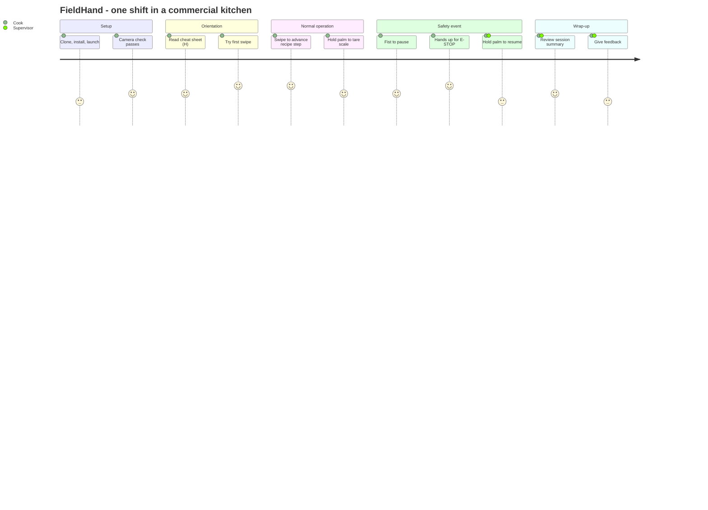

# Design.md — FieldHand UX & Visual Framework

| Field | Value |
|---|---|
| Document | `Design.md` v0.1 |
| Owner | Member 1 (Product & UX Lead) |
| Surface | Single desktop window (OpenCV), 1280×720 requested, mirrored webcam feed with HUD overlay |
| Related | `PRD.md` (features F-01…F-22, user stories US-01…US-07), `Architecture.md` (`hud.py`, `config.py`) |

---

## 0. Design principles

| # | Principle | What it means on screen |
|---|---|---|
| P1 | **Feedback before action** | Every hold-to-confirm gesture shows a progress ring *before* it commits. Users always know a gesture is being recognised. |
| P2 | **Fail-safe asymmetry** | Stopping is fast and forgiving (0.5 s fist, instant two-hand E-STOP). Restarting is slow and deliberate (2–3 s palm hold). |
| P3 | **Readable from 2 metres** | Hands are busy and the laptop may be on a counter or workbench. Large type, high contrast, few words. |
| P4 | **Never colour alone** | Status chips pair colour with a text label and an icon shape, so they work for colour-blind users and in glare. |
| P5 | **Mirror view** | The feed is mirrored like a selfie. Moving a hand right in real life moves it right on screen, and "swipe right" means the next step. |
| P6 | **One thing at a time** | Stopped states (PAUSED, E-STOP) take over the screen and ignore every gesture except resume. |

---

## 1. Wireframes

Low-fidelity, monospaced. Numbers in parentheses map to the annotation tables. Values shown (FPS, timers, counts) are **illustrative**.

### 1.1 Screen map

| ID | Screen | Trigger | Related features |
|---|---|---|---|
| W1 | Launch / camera check | App start | F-01, F-02, F-10 |
| W2 | Main HUD (RUNNING) | SPACE on W1 | F-08, F-09 |
| W3 | Dwell ring (zoom on the hand) | Open palm or fist recognised | F-05 |
| W4 | PAUSED overlay | Fist held 0.5 s | F-06 |
| W5 | E-STOP overlay | Two hands up | F-06, F-07 |
| W6 | Help overlay | `H` key | F-15 |
| W7 | Session summary | `Q` key | F-19 |

### W1 - Launch / camera check
```text
+------------------------------------------------------------------------+
|                                                                        |
|          (1) FieldHand                                                 |
|          Touchless control for farm sheds and kitchens                 |
|                                                                        |
|   (2) Camera check:   [ OK ] Webcam 0 found, 1280x720                  |
|                       [ OK ] MediaPipe Hands loaded                    |
|                       [ -- ] Hand detected  (raise a hand)             |
|                                                                        |
|   (3) [ SPACE = start ]    [ H = gestures ]    [ Q = quit ]            |
|                                                                        |
|   (4) Tip: stand 0.5-1.5 m away, hands in view, good light on you      |
+------------------------------------------------------------------------+
```

| Ref | Element | Behaviour |
|---|---|---|
| 1 | Title and tagline | Static. |
| 2 | Camera check list | Each row flips from `[ -- ]` to `[ OK ]` when its check passes. On failure it shows `[FAIL]` in the danger colour with a one-line fix (for example: "Try `--camera 1`"). The hand row updates live. |
| 3 | Start / help / quit | Keyboard is fine here because setup happens before hands get dirty. SPACE starts the session. |
| 4 | Placement tip | Static; repeated in the README. |

### W2 - Main HUD (state: RUNNING)
```text
+------------------------------------------------------------------------+
| (1) [* RUNNING]       FieldHand | Tomato Salsa        (2) 28 FPS       |
+--------------------------+--------------------------+------------------+
| (3) RECIPE  Step 2 of 6  |                          | (5) SCALE        |
| +----------------------+ |                          |      0 g         |
| | Place bowl on scale, | |  (live webcam feed,      | palm 1s = TARE   |
| | then TARE            | |   mirrored, with         |                  |
| +----------------------+ |   hand skeleton)         | (6) MACHINE      |
|  < swipe L   swipe R >   |                          | Mixer     00:42  |
|                          |           (4)            | [=====>      ]   |
|                          |          ( o )           | state: RUNNING   |
+--------------------------+--------------------------+------------------+
| (7) PALM 1s: TARE | SWIPE: STEP | FIST .5s: PAUSE | 2 HANDS UP: E-STOP |
| (8) Toast: Step advanced >              (fades after 2 s)              |
+------------------------------------------------------------------------+
```

| Ref | Element | Behaviour |
|---|---|---|
| 1 | Status chip | Always visible, top-left. Green `●` **RUNNING**, amber `❚❚` **PAUSED**, red `■` **E-STOP**. Colour, icon and word all change together. |
| 2 | FPS readout | Updates once per second. Turns amber below 20 FPS to warn that gestures may lag. |
| 3 | Recipe card | Current step in ≤ 2 lines of large text. The `<` and `>` hints briefly highlight when a swipe registers. Step counter shows "n of N". |
| 4 | Hand and skeleton | Full-frame mirrored feed. Skeleton is neutral grey while tracking, **green** when the pose is valid for a command. The primary hand (largest palm) gets a thicker outline. |
| 5 | Scale panel | Large digits. On `TARE` the reading flashes to 0 g and the label pulses once. In the demo, `W`/`S` add or remove 100 g. |
| 6 | Machine panel | Cycle countdown and progress bar. Freezes (and dims to 50 %) in PAUSED and E-STOP. |
| 7 | Hint strip | Permanent one-line cheat sheet so users never need a manual. |
| 8 | Toast | Shows the last command with an arrow or icon. Fades after 2 s. Never covers the status chip. |

### W3 - Gesture in progress (dwell ring), zoomed on the hand
```text
+----------------------------------------------+
| (1) Skeleton turns GREEN when pose is valid  |
|                                              |
|            .-----------.                     |
|           /   (2) 62%   \                    |
|          |  ring fills   |                   |
|           \  clockwise  /                    |
|            '-----------'                     |
|                                              |
| (3) Label: 'Hold to TARE'                    |
| (4) Moving the hand or changing pose RESETS  |
|     the ring to 0% (no partial commits)      |
+----------------------------------------------+
```

| Ref | Element | Behaviour |
|---|---|---|
| 1 | Skeleton colour | Switches grey → green the moment the target pose is recognised (after the 3-frame debounce). |
| 2 | Progress ring | Drawn around the wrist, fills clockwise from 0 to 100 % over the dwell time (1.0 s tare, 0.5 s pause, 2.0 / 3.0 s resume). On completion it flashes white once and the toast appears. |
| 3 | Action label | Names what will happen ("Hold to TARE", "Hold to PAUSE", "Hold to RESUME"). |
| 4 | Reset rule | Moving more than about one palm-width or changing pose snaps the ring back to 0 %. Gestures never half-commit. |

### W4 - PAUSED overlay (amber)
```text
+------------------------------------------------------------------------+
| (1) [|| PAUSED]      Machine timer frozen             28 FPS           |
|                                                                        |
|        (2)  PAUSED - closed fist detected                              |
|                                                                        |
|        (3)  To resume: hold OPEN PALM for 2 s     ( ring )             |
|        (4)  All other gestures are ignored while paused                |
|                                                                        |
|        (5)  Mixer  00:42  (frozen)     Scale  0 g                      |
+------------------------------------------------------------------------+
```

| Ref | Element | Behaviour |
|---|---|---|
| 1 | Amber chip and banner | Amber banner across the top; camera feed dims slightly (alpha 0.7 dark overlay). |
| 2 | Headline | Names the cause so the user knows why the machine stopped. |
| 3 | Resume instruction | Shows the single accepted gesture plus the ring while it fills. |
| 4 | Lock notice | Swipes, tare and fist are ignored. `ESTOP` is still accepted. |
| 5 | Frozen readouts | Last values remain visible but dimmed to 50 %. |

### W5 - E-STOP overlay (red, latched)
```text
+------------------------------------------------------------------------+
| (1) [# E-STOP]       RED BORDER, 2 Hz flash            28 FPS          |
|                                                                        |
|        (2)  E-STOP - two hands up detected                             |
|                                                                        |
|        (3)  Stopped for 00:07                                          |
|        (4)  To reset: hold OPEN PALM for 3 s      ( ring )             |
|                                                                        |
|        (5)  Prototype only - not a certified safety system             |
+------------------------------------------------------------------------+
```

| Ref | Element | Behaviour |
|---|---|---|
| 1 | Red chip and border | Border flashes at 2 Hz (below the 3-flashes-per-second photosensitivity threshold). Feed dims more than PAUSED. |
| 2 | Headline | Names the cause. |
| 3 | Elapsed time | Counts up since the stop. |
| 4 | Reset instruction | Longer hold (3 s) than pause (2 s) by design. |
| 5 | Disclaimer | Always shown here and in the README. |

### W6 - Help overlay (press H)
```text
+------------------------------------------------------------------------+
| GESTURE CHEAT SHEET                                   [H] close        |
|                                                                        |
|  SWIPE RIGHT         -> next recipe step                               |
|  SWIPE LEFT          -> previous recipe step                           |
|  OPEN PALM (1 s)     -> tare the scale                                 |
|  CLOSED FIST (0.5 s) -> pause the machine                              |
|  TWO HANDS UP        -> EMERGENCY STOP (instant, latched)              |
|  OPEN PALM (2 s)     -> resume from pause   (3 s from E-STOP)          |
|                                                                        |
|  Keys: W/S = add/remove 100 g (scale sim)   D = debug   Q = quit       |
+------------------------------------------------------------------------+
```
Annotation: semi-transparent panel over the feed; toggles with `H`; gestures keep working underneath, so a user can learn while the app runs. Content is generated from the gesture table in `PRD.md` §2.1 so the two never drift.

### W7 - Session summary (on quit)
```text
+------------------------------------------------------------------------+
| SESSION SUMMARY                                                        |
|                                                                        |
|  Duration            00:05:12                                          |
|  Commands executed   14   (steps 9, tare 3, pause 1, e-stop 1)         |
|  Avg FPS             27.4                                              |
|  Slowest E-STOP      212 ms   (gesture satisfied -> state change)      |
|  Event log saved to  logs/session_YYYYMMDD_HHMMSS.csv                  |
|                                                                        |
|  [ SPACE = new session ]        [ Q = exit ]                           |
+------------------------------------------------------------------------+
```
Annotation: values come from the session's event log. This screen is the quickest way to capture KPIs K2 and K3 for `Log.md`.

---

## 2. Color Scheme & Typography

### 2.1 Palette

A dark, low-glare theme: the camera feed is the hero, panels sit on semi-transparent dark surfaces, and status colours carry meaning. **OpenCV uses BGR order**, so `config.py` stores the BGR tuples.

| Role | Hex | BGR (for OpenCV) | Used for |
|---|---|---|---|
| Background | `#101612` | `(18, 22, 16)` | Overlay tint, dimming layers |
| Surface | `#1B2620` | `(32, 38, 27)` | Panels and cards (drawn at ~70 % alpha with `cv2.addWeighted`) |
| Primary / RUNNING | `#3DDC84` | `(132, 220, 61)` | RUNNING chip, valid-pose skeleton, ring fill |
| Info | `#4FC3F7` | `(247, 195, 79)` | Hints, step counter, neutral highlights |
| Warning / PAUSED | `#FFC107` | `(7, 193, 255)` | PAUSED chip, low-FPS warning |
| Danger / E-STOP | `#FF3B30` | `(48, 59, 255)` | E-STOP chip, border, `[FAIL]` rows |
| Text primary | `#F4F7F2` | `(242, 247, 244)` | Headlines, readings |
| Text secondary | `#A9B8AD` | `(173, 184, 169)` | Labels, hint strip |

**Colour rules**

- Body text on any panel targets contrast ≥ 7:1; large HUD text ≥ 4.5:1 (WCAG AA). Verify with a contrast checker before freeze.
- Meaning is never carried by colour alone: chip colour + icon shape + text label (P4).
- Red is reserved for E-STOP and failures. Green is reserved for "running / valid".
- Test the HUD once under bright light or glare; if a colour washes out, increase panel alpha rather than adding new colours.

### 2.2 Typography

| Layer | Font | Notes |
|---|---|---|
| In-app HUD (default) | OpenCV `FONT_HERSHEY_DUPLEX` | Zero extra dependencies; clearer than the simplex family at distance. |
| In-app HUD (optional upgrade) | Inter Bold via Pillow | Optional polish, not in the PRD feature list. Only if all Must items are done. |
| Docs, README | System sans (Inter if available) | |
| Code, logs, hint strip | JetBrains Mono / system monospace | |

**HUD type scale (1280×720; sizes are OpenCV `fontScale`, check legibility from 2 m)**

| Element | Scale | Thickness | Colour |
|---|---|---|---|
| Status chip label | 1.1 | 2 | Text primary on status colour |
| Recipe step text | 0.9 | 2 | Text primary |
| Scale reading | 1.6 | 3 | Text primary |
| Machine timer | 1.2 | 2 | Text primary |
| Toast | 0.8 | 2 | Text primary |
| Hint strip | 0.6 | 1 | Text secondary |

Rules: no HUD text below scale 0.6; max 2 lines per card; sentence case except status words (RUNNING, PAUSED, E-STOP) which are upper case.

### 2.3 Layout grid

- Window 1280×720, 24 px outer margin, 16 px gutters.
- Left panel ≈ 28 % width (recipe), right panel ≈ 18 % (scale and machine), centre stays clear for hands.
- Hint strip and toast live in a 96 px bottom band.
- The centre third of the frame is never covered by UI, because that is where the user's hands are.

### 2.4 Accessibility and environment checklist

- [ ] Status readable without colour (icon + word).
- [ ] Flash rate ≤ 2 Hz for E-STOP.
- [ ] Readable from 2 m on the target laptop.
- [ ] Works in warm kitchen light and in cooler shed light (test both if possible).
- [ ] Left-handed and right-handed use both work (no handedness labels are used).

---

## 3. User Journey

Persona: **Asha, a cook in a commercial kitchen**. The same flow applies to a farm-shed operator with the machine panel in focus.



| Stage | Touchpoint | User action | System response | Emotion | Pain point | Design response |
|---|---|---|---|---|---|---|
| 1. Setup | README, terminal, W1 | Clone, install, run, check camera | Camera check turns `[ OK ]` | Neutral, slightly unsure | Install friction; wrong camera index | One-command run; `[FAIL]` rows with a one-line fix |
| 2. Orientation | W1 tip, W6 help | Reads cheat sheet, raises a hand | Skeleton appears; hint strip visible | Curious | "What gestures exist?" | Permanent hint strip; `H` overlay |
| 3. Normal operation | W2, W3 | Swipes to advance; holds palm to tare | Toast, ring, device reaction | Confident | Wondering whether it noticed the gesture | Ring before commit (P1); toast after |
| 4. Interruption | W4, W5 | Fist to pause or both hands up to stop | Full-screen amber or red state, timer frozen | Alert, relieved | Fear of accidental restart | Slow resume (P2); all other gestures locked |
| 5. Recovery | W4, W5 | Holds open palm 2–3 s | Ring fills; state returns to RUNNING | Calm | Impatience during the hold | Visible ring; clear instruction text |
| 6. Wrap-up | W7, `events.csv` | Presses `Q`; reads the summary | Summary and saved log path | Satisfied | Not knowing what was recorded | Summary lists exactly what is saved; no images stored |
| 7. Feedback (post-launch) | SUS form, interview | Rates and comments | Notes added to `Log.md` | Engaged | Survey fatigue | One-question survey plus a short interview |

### Touchpoint inventory

| Touchpoint | Owner | Related task in `To-Do.md` |
|---|---|---|
| README (install, gestures, limits, disclaimer) | Member 1 | T-26 |
| Camera check / launch screen | Member 1 | S-02 |
| HUD, ring, toasts | Member 1 | T-16, T-17 |
| PAUSED and E-STOP overlays | Member 1 | T-18 |
| Help overlay and session summary | Member 1 | S-01 |
| Event log (`events.csv`) | Member 2 | T-20 |

### Design acceptance checklist

- [ ] W2, W4 and W5 implemented to match the wireframes (layout, copy, colours).
- [ ] Dwell ring visible for every hold gesture.
- [ ] Contrast and legibility checked from 2 m.
- [ ] Disclaimer visible on W5 and in the README.
